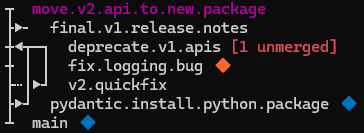
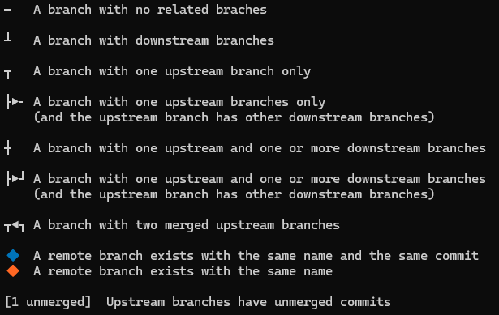

## git graph-branch

This tool provides a visual representation of the branches in your repository, including their relationships to upstream and merge branches.

### Quick Start

Install this tool using [uv][]:

[uv]: https://docs.astral.sh/uv/

```bash
$ uv tool install git+https://github.com/alicederyn/git-graph-branch.git
```

It will appear as a sub-command of `git`:

```bash
$ git graph-branch
```

### Help docs

```text
usage: git-graph-branch [-h] [--color] [--remote-icons] [--pr-icons] [-w] [--poll-every SECS]

Pretty-print branch metadata

options:
  -h, --help         show this help message and exit
  --color            Display colorized output; defaults to true if the output is a TTY and NO_COLOR is not set
  --remote-icons     Display remote status icon; defaults to true if the output is a TTY
  --pr-icons         Display PR check status icon; defaults to true if the output is a TTY

watch options:
  -w, --watch        Watch for changes and keep the graph updated
  --poll-every SECS  If watching, how often to poll for changes (default: 1.0)
```

### Watch mode

```bash
$ git graph-branch --watch
```

The graph takes over the terminal and updates whenever your branches or commits change. It opens on your current branch, and follows it when you check out another branch. Press `q` or Ctrl-C to quit.

To see the rest of a long graph, scroll with the mouse wheel, the Up/Down arrow keys, Page Up/Page Down, or Home/End. If you scroll your current branch out of view, the graph stays where you left it. Once your branch is back in view, the graph follows it again.

A plain drag does not select text in watch mode. In most terminals, hold Shift while you drag. In iTerm2, hold Option instead.

### PR check status

If a branch's remote branch has an open pull request on GitHub, an icon shows the status of its checks: ❌ if any check failed, ⌛ if none failed and some are pending, ✅ if all passed, and ⚠️ if the status could not be loaded.

This needs a token in an environment variable named after the first part of the GitHub domain: `GITHUB_TOKEN` for github.com, or `EXAMPLE_TOKEN` for example.com. git-graph-branch uses the `http.proxy` and `http.sslcainfo` settings from your git config.

In watch mode, the status is checked every few seconds just after you push, and less often after that. In tmux, git-graph-branch does not check while its window is not visible. While it runs, it keeps a tmux session named `_git-graph-branch-<pid>`.

### Sample output



Related branches are connected via lines; upstream branches are displayed further down the page. This allows rapidly grasping the structure of the branches.

To condense the information, the output is optimized for fonts like Hack or Cascadia Mono which correctly render box-drawing characters. It may display less well with other fonts.



### Recommended git configuration

git-graph-branch relies on your branches having upstream information set, which is not the case with git's defaults. To get the best out of git-graph-branch, I recommend a few configuration changes to your git checkout (`/path/to/repo/.git/config`, or `~/.gitconfig` if you would like to make these changes to every checkout):

```text
# Set upstream information when you run git checkout -b <branch>
[branch]
    autosetupmerge = always

# Ensure a plain git push will continue to work as expected
[push]
    default = simple
[remote]
    pushdefault = origin

# Keep branch history for longer
[gc]
    auto = 100000
```

If you have not used these defaults before, you may need to set up upstream information for your existing branches as a one-off. For instance, if `feature/foo` is going to be applied to `main`, run `git branch feature/foo --set-upstream-to=main`. Once you have made the config changes above, `git checkout main -b feature/foo` will set this upstream information for you automatically.
